# 🚀 LeavePro — Employee Leave Management System

<div align="center">


<p align="center">
  <strong>LeavePro</strong> is a full-featured, enterprise-grade Employee Leave Management SaaS application built with React.js. It delivers seamless role-based workflows for both employees and managers, real-time leave entitlement calculations, automated balance deductions, search/filtering, and responsive layouts.
</p>

[✨ Live Preview](#-getting-started--run-instructions) • [📸 UI Showcase](#-user-interface-showcase) • [🖼️ Live Screenshots](#️-live-application-screenshots-output-showcase) • [📁 Project Structure](#-folder--file-structure) • [👥 Team Directory](#-team-directory--demo-accounts) • [⚡ Features](#-key-features--business-rules)

</div>

---

## 📸 User Interface Showcase

The system is built to match the pixel-accurate SaaS design specifications:

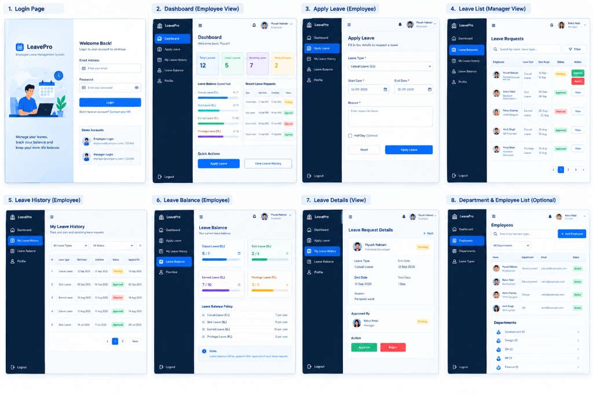

### 🖥️ 8 Core Screen Views Included:
1. **Login Page**: Split-layout screen with custom workspace vector illustration, credential validation, show/hide password toggle, and interactive one-click demo login cards.
2. **Employee Dashboard**: Welcome header, 4 metric cards (Total, Used, Remaining, Pending), real-time progress bars by leave type (CL, SL, EL, PL), recent leave requests, and quick action buttons.
3. **Apply Leave (Employee)**: Comprehensive form with leave type dropdown, date pickers, optional half-day (0.5 day) logic, reason textarea, remaining balance guard, and form reset.
4. **Leave List (Manager View)**: Real-time search by employee name or reason, filter by status (Pending, Approved, Rejected) & leave type, with quick Approve / Reject actions and pagination.
5. **My Leave History (Employee)**: Isolated view showing personal requests with status badges, date ranges, applied dates, and detailed view modals.
6. **Leave Balance (Employee)**: 4 balance cards with color-coded progress bars, company leave policy summary (27 annual days), and live entitlement status.
7. **Leave Request Details**: Complete application dossier with employee details, department, duration, reason, approver information, and manager approval/rejection modal.
8. **Employees & Departments Directory**: Comprehensive team directory with working Add Employee and Add Department modals and department breakdowns.

---

## 🖼️ Live Application Screenshots (Output Showcase)

High-resolution screenshots captured directly from the running LeavePro application covering both Employee and Manager user journeys:

---

### 🔐 1. Authentication & Role-Based Demo Login

#### A. Split-Screen Login View
> Modern split-screen layout with custom SVG workspace illustration, credential validation, show/hide password toggle, and interactive one-click demo accounts.

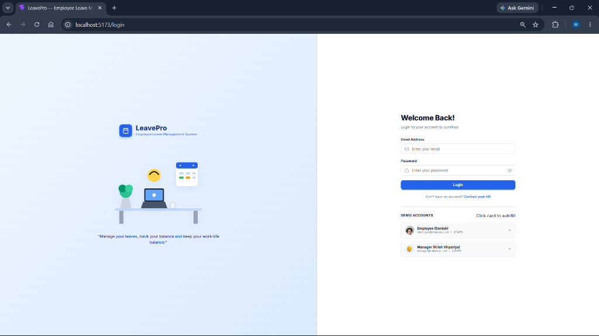

#### B. One-Click Employee Autofill (`employee@company.com`)
> Clicking the Employee card automatically inputs test credentials and highlights the active selection.

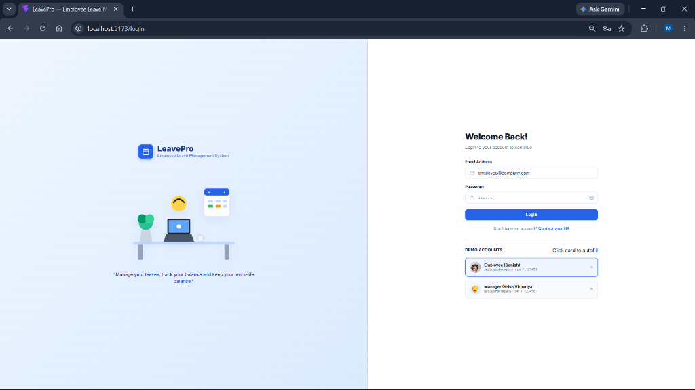

#### C. One-Click Manager Autofill (`manager@company.com`)
> Clicking the Manager card instantly fills manager credentials with Krish Virpariya's boy emoji avatar (👦).

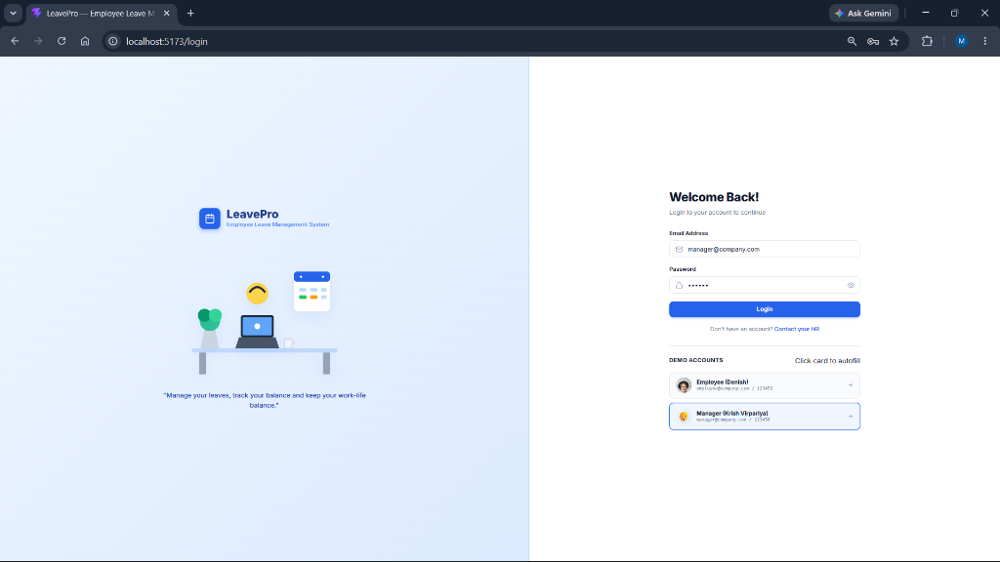

---

### 👨‍💻 2. Employee Portal & Self-Service Experience

#### A. Employee Dashboard (`/employee/dashboard`)
> Complete dashboard overview showing 4 Metric Cards (Total: 27, Used: 5, Remaining: 22, Pending: 1), Leave Balance progress bars (CL, SL, EL, PL), and Recent Leave Requests table.

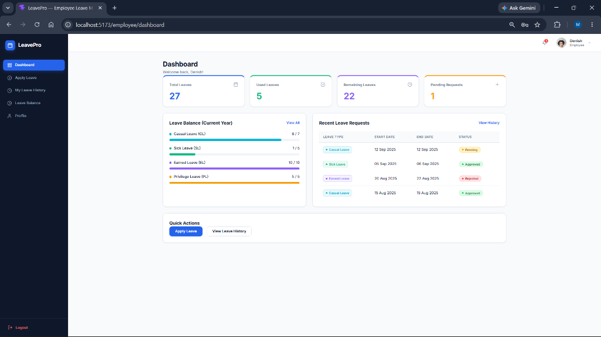

#### B. Apply Leave Application Form (`/employee/apply-leave`)
> Leave request form with leave type dropdown, inclusive date pickers, optional half-day (0.5 day) checkbox, reason textarea, and reset/submit actions.

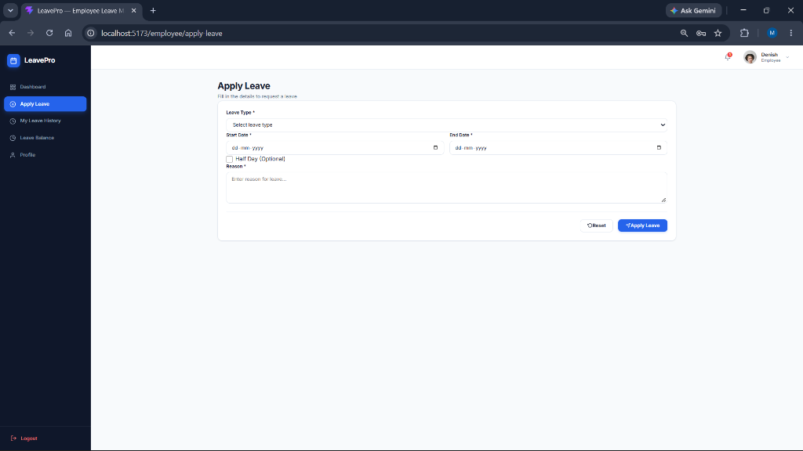

#### C. My Leave History (`/employee/leave-history`)
> Filterable personal leave history with status pill badges (Pending, Approved, Rejected), date ranges, applied dates, and View action buttons.

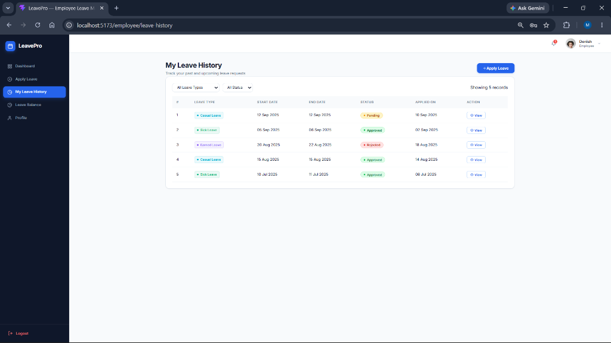

#### D. Leave Balance & Available Days Cards (`/employee/leave-balance`)
> Real-time leave balance breakdown featuring 4 color-coded cards (CL: 6/7, SL: 1/5, EL: 10/10, PL: 5/5) with used vs available trackers, entitlement table (27 Days/Year), and approval deduction notes.

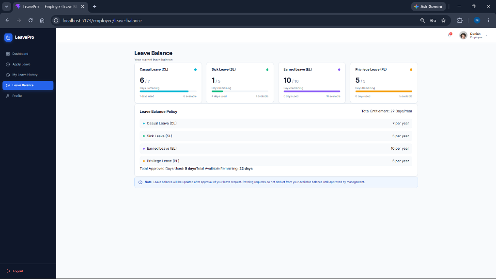

---

### ⚡ 3. Manager Approval Queue & Leave Management

#### A. Manager Leave Requests Queue — Pending Actions (`/manager/leave-requests`)
> Real-time management queue with direct interactive **Approve** (green) and **Reject** (red) controls, multi-filter search, and pagination.

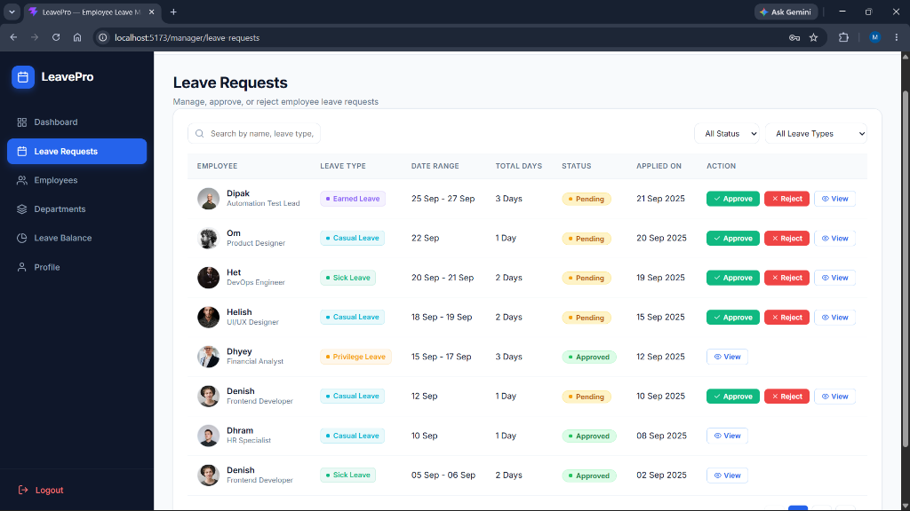

#### B. Leave Requests Audit Trail — Processed Requests (`/manager/leave-requests`)
> Paginated request audit trail displaying approved leaves and rejected applications with feedback remarks.

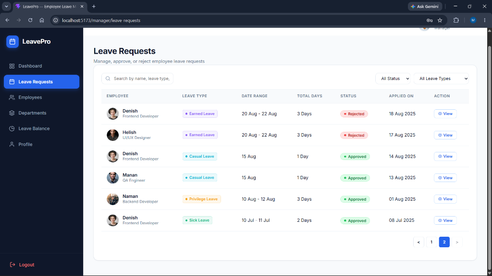

---

### 👥 4. Organization Directory & Department Management

#### A. Employee Directory & Search (`/manager/employees`)
> Complete team directory with real-time name/email/designation search, department filter dropdown, and "+ Add Employee" modal action.

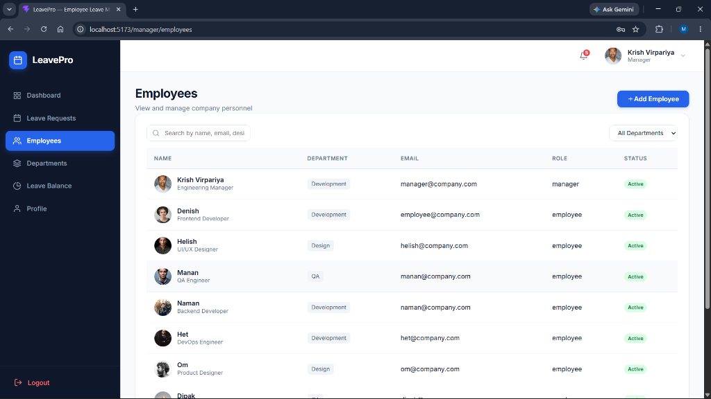

#### B. Complete Team Member Roster (`/manager/employees`)
> Complete active list of all 10 organization members (Krish Virpariya, Denish, Helish, Manan, Naman, Het, Om, Dipak, Dhram, Dhyey).

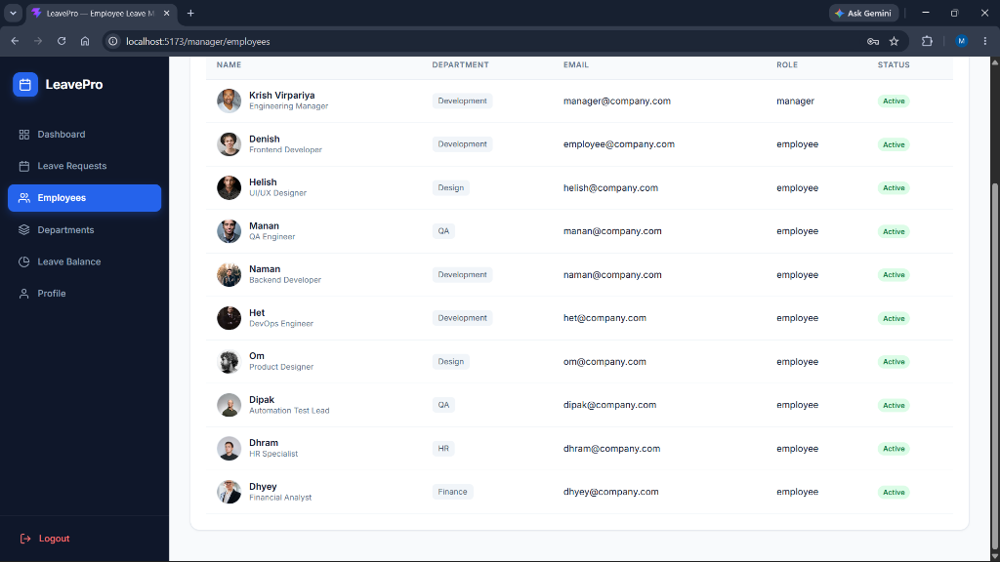

#### C. Departments Management (`/manager/departments`)
> Department cards overview showing team size counters, unit descriptions, and "+ Add Department" button.

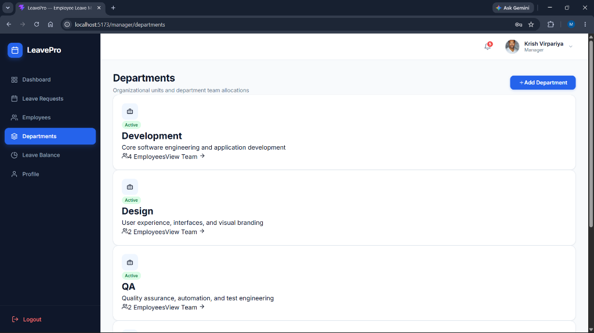

#### D. Department Teams Allocation Breakdown (`/manager/departments`)
> Detailed organizational breakdown of Development, Design, QA, HR, and Finance departments.

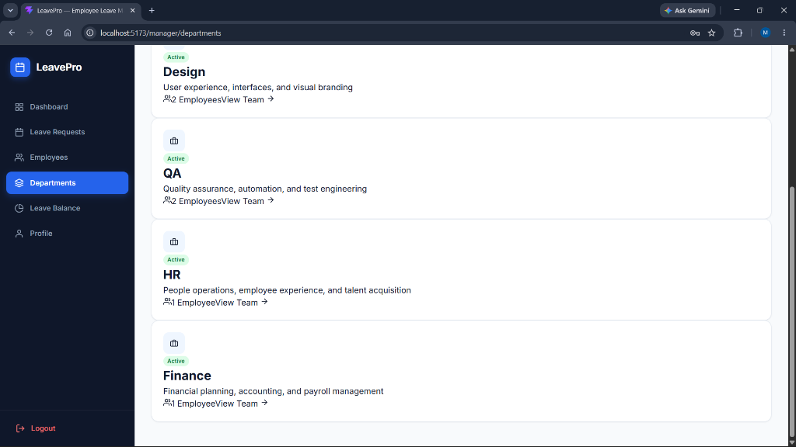

---

### 👤 5. User Profile, Header Navigation & Policies

#### A. Manager User Profile & Account Dossier (`/manager/profile`)
> Manager profile screen showing Krish Virpariya's boy emoji avatar (👦), phone number (`+91 94273 85972`), joined date (`05 Jan 2025`), and reporting lines.


#### B. Employee User Profile & Reporting Line (`/employee/profile`)
> Employee personal profile screen for Denish (`EMP-1`), displaying his male avatar photo, contact (`+91 98765 43210`), joined date (`15 Jan 2025`), and reporting line to Krish Virpariya (Manager).

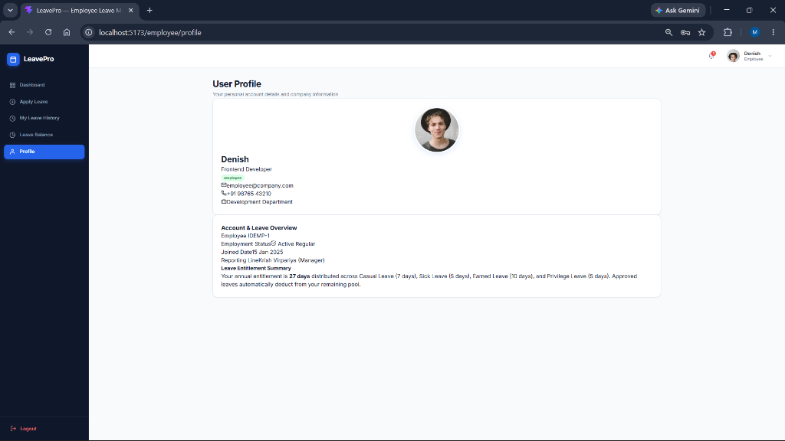

#### C. Top Navbar User Navigation & Dropdown
> Top navbar profile dropdown menu displaying active user card, Profile Details navigation, and secure session Logout.

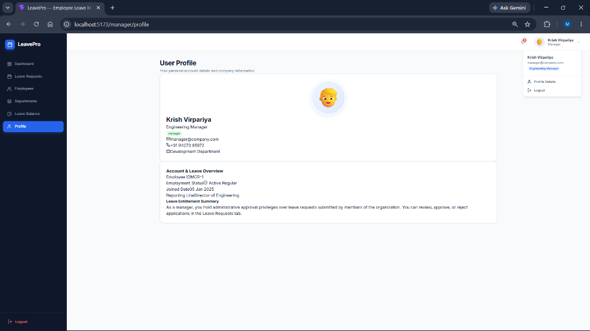

#### D. Annual Leave Balance Policy (`/manager/leave-balance`)
> Transparent company policy overview specifying annual quotas (CL: 7d, SL: 5d, EL: 10d, PL: 5d) totalling 27 Days/Year.

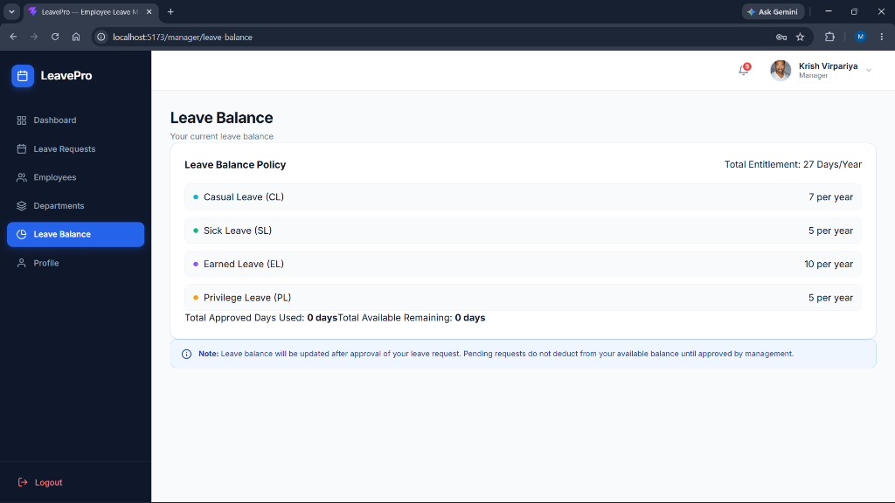

---

## 👨‍💻 Author Information

- **Lead Developer & Designer**: **Krish Virpariya**
- **Project**: LeavePro — Employee Leave Management System
- **Technologies**: React.js, React Hooks, React Router, Context API, Vanilla CSS3, LocalStorage REST API

---

## 👥 Team Directory & Demo Accounts

All credentials use password `123456` for instant demonstration and testing.

### 🛡️ Manager Account
| User ID | Full Name | Role | Designation | Department | Phone | Joined Date | Login Email | Password |
| :--- | :--- | :--- | :--- | :--- | :--- | :--- | :--- | :--- |
| **`mgr-1`** | **Krish Virpariya** | **Manager** | **Engineering Manager** | Development | **`+91 94273 85972`** | `2025-01-05` | `manager@company.com` *(or `krish@company.com`)* | `123456` |

---

### 💼 Employee Accounts (All Team Members)
| User ID | Employee Name | Role | Designation | Department | Phone | Joined Date | Login Email | Password |
| :--- | :--- | :--- | :--- | :--- | :--- | :--- | :--- | :--- |
| **`emp-1`** | **Denish** | Employee | Frontend Developer | Development | `+91 98765 43210` | `2025-01-15` | `employee@company.com` | `123456` |
| **`emp-2`** | **Helish** | Employee | UI/UX Designer | Design | `+91 98765 67890` | `2025-01-20` | `helish@company.com` | `123456` |
| **`emp-3`** | **Manan** | Employee | QA Engineer | QA | `+91 98765 89012` | `2025-02-01` | `manan@company.com` | `123456` |
| **`emp-4`** | **Naman** | Employee | Backend Developer | Development | `+91 98765 34567` | `2025-02-10` | `naman@company.com` | `123456` |
| **`emp-5`** | **Het** | Employee | DevOps Engineer | Development | `+91 98765 45678` | `2025-02-15` | `het@company.com` | `123456` |
| **`emp-6`** | **Om** | Employee | Product Designer | Design | `+91 98765 56789` | `2025-03-01` | `om@company.com` | `123456` |
| **`emp-7`** | **Dipak** | Employee | Automation Test Lead | QA | `+91 98765 77889` | `2025-03-10` | `dipak@company.com` | `123456` |
| **`emp-8`** | **Dhram** | Employee | HR Specialist | HR | `+91 98765 88990` | `2025-03-15` | `dhram@company.com` | `123456` |
| **`emp-9`** | **Dhyey** | Employee | Financial Analyst | Finance | `+91 98765 99001` | `2025-04-01` | `dhyey@company.com` | `123456` |

> 💡 **Tip**: Krish Virpariya (Manager) is styled with a sharp boy emoji avatar (👦), all 9 employees have handsome male avatars, and all team members joined in 2025!

---

## 📁 Folder & File Structure

The project strictly follows the requested modular architecture:

```
src/
├── components/
│   ├── Sidebar.jsx           # Navy-blue sidebar with role-aware navigation & logout
│   ├── Header.jsx            # Top navbar with notifications, user avatar & dropdown menu
│   ├── LeaveCard.jsx         # 4-card metric counters for dashboard overviews
│   ├── LeaveTable.jsx        # Reusable table with filtering, pagination & status actions
│   ├── StatusBadge.jsx       # Status pill badges (Pending, Approved, Rejected)
│   ├── LeaveTypeBadge.jsx    # Tag component with color-coded dot indicator (CL, SL, EL, PL)
│   └── LeaveBalanceCard.jsx  # Balance cards & progress bars matching screens 2 & 6
├── pages/
│   ├── Login.jsx             # Split-layout login matching UI screen 1 with demo autofill
│   ├── EmployeeDashboard.jsx # Employee dashboard matching UI screen 2
│   ├── ManagerDashboard.jsx  # Manager dashboard with quick navigation & request queues
│   ├── ApplyLeave.jsx        # Leave submission form with real-time balance validation
│   ├── LeaveHistory.jsx      # Employee personal leave history with type/status filters
│   ├── LeaveBalance.jsx      # 4 balance cards, annual entitlement policy & info banner
│   ├── LeaveDetails.jsx      # Request details, approver info & manager action controls
│   ├── LeaveRequests.jsx     # Manager request queue with search, filter, approve/reject
│   ├── Employees.jsx         # Employee directory with search, filter & Add Employee modal
│   └── Departments.jsx       # Department listing with team modals and Add Department
├── services/
│   └── api.js                # Full simulated REST API with LocalStorage persistence
├── hooks/
│   └── useLeaves.js          # Centralized custom hook for all leave operations
├── utils/
│   ├── leaveUtils.js         # Inclusive calendar day calculations, balances, filters
│   └── validation.js         # Comprehensive form & business limits validation
├── data/
│   └── mockData.json         # Seed dataset with employees, departments, leave types & requests
├── App.jsx                   # React Router route hierarchy and role shielding
└── main.jsx                  # Application entry point
```

---

## ⚡ Key Features & Business Rules

### 1. 📅 Leave Entitlement Policy
- **Casual Leave (CL)**: 7 days / year
- **Sick Leave (SL)**: 5 days / year
- **Earned Leave (EL)**: 10 days / year
- **Privilege Leave (PL)**: 5 days / year
- **Total Annual Entitlement**: **27 Days**

### 2. 🧮 Duration & Balance Calculation Logic
- **Inclusive Dates**: Duration is calculated inclusively from Start Date to End Date (e.g. `12 Sep` to `12 Sep` = 1 Day; `12 Sep` to `14 Sep` = 3 Days).
- **Half-Day Leave**: Allows 0.5 Day leave, automatically constrained to a single-date selection.
- **Pending & Rejected Statuses**: Do **not** deduct from the employee's available leave balance.
- **Approved Status**: Only approved leave days deduct from the corresponding leave type and recalculate remaining days dynamically.
- **Overdraft Prevention**: Form validation checks available balance in real-time and blocks submission if requested days exceed remaining balance.

### 3. 🛡️ Role Protection & Security
- **Route Guards**: `ProtectedRoute` checks session authentication and redirects employees trying to access `/manager/*` routes back to `/employee/dashboard`.
- **Action Isolation**: Approval and Rejection buttons are strictly hidden from employees.
- **Duplicate Prevention**: State transitions enforce that finalized requests (Approved / Rejected) cannot be re-processed.

### 4. 💻 Optimized Responsive Layouts
- **Laptop (1024px) & Laptop L (1440px)**: Persistent sidebar navigation; the 3-line hamburger menu is cleanly hidden for a distraction-free desktop experience.
- **Mobile (< 1024px)**: Slide-out drawer sidebar with overlay backdrop and responsive header controls.

---

## 🚀 Getting Started & Run Instructions

### Prerequisites
- [Node.js](https://nodejs.org/) (v18.0.0 or higher recommended)
- `npm` or `yarn`

### 1. Installation
Clone or navigate to the project directory:
```bash
cd "c:\destop1\Desktop\Leave Management System"
npm install
```

### 2. Start Development Server
```bash
npm run dev
```
Open your browser and navigate to:
```
http://127.0.0.1:5173/
```

### 3. Build for Production
```bash
npm run build
```
Creates an optimized production bundle in the `dist/` directory.

---

## 🧪 Verified Workflow Testing

1. **Employee Application**:
   - Sign in as `employee@company.com` (`123456`).
   - Go to **Apply Leave**, select leave type, choose dates, enter reason, and submit.
   - Status is initialized to **Pending**; remaining balance is untouched.
2. **Manager Review**:
   - Sign out and sign in as `manager@company.com` (`123456`).
   - Navigate to **Leave Requests**, search for **Denish**, and click **Approve** (or **Reject** with confirmation reason).
   - Approver **Krish Virpariya** and timestamps are recorded.
3. **Cross-Role Reflection**:
   - Sign back in as **Denish**; the dashboard immediately displays the **Approved** status and deducted leave balances in real-time.

---

<div align="center">
  <sub>Developed with ❤️ by <strong>Krish Virpariya</strong> for <strong>LeavePro HR System</strong>.</sub>
</div>
